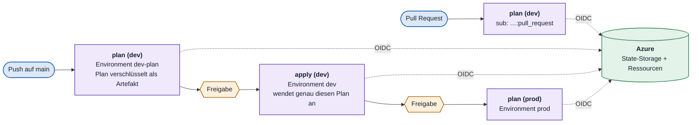

# Azure Private AKS Platform

Eine kleine, produktionsnahe Azure-Umgebung, vollständig mit **OpenTofu** bereitgestellt: AKS, Key Vault und Storage Account, die **ausschließlich über private IPs** miteinander sprechen – mit verschlüsseltem Remote State ohne Access Keys und einer Pipeline (GitHub Actions) ohne gespeicherte Cloud-Credentials, mit Freigabe zwischen Plan und Apply.

**Designannahmen**, wie man sie in Unternehmensumgebungen häufig antrifft:

- Zugriff nur auf **eine vorgegebene Resource Group** (z. B. aus einer Landing Zone) – keine Rechte auf Subscription-Ebene nötig.
- Datenverkehr zwischen Cluster und Diensten **nur privat**; öffentliche Endpunkte geschlossen oder auf Admin- bzw. Runner-IPs beschränkt.
- **Keine gespeicherten Zugangsdaten** (Client Secrets, Access Keys) – weder in der Pipeline noch im Cluster; Secret-Werte nicht im State.

|            |                                                                                           |
| ---------- | ----------------------------------------------------------------------------------------- |
| IaC        | OpenTofu ≥ 1.10 (getestet mit 1.13.1), Provider `azurerm` 4.x (getestet mit 4.81)         |
| Umgebungen | `dev` (deployed), `prod` (gleicher Code, eigene Werte; in der Pipeline nur `plan`)        |
| Pipeline   | GitHub Actions, Anmeldung per OIDC (Workload Identity Federation), Freigabe vor `apply`   |
| State      | Azure Storage ohne Access Keys, **State und gespeicherte Pläne verschlüsselt** (OpenTofu) |
| Region     | Variable `location` (getestet in `westeurope` und `swedencentral`)                        |

---

## Inhalt

1. [Architektur](#1-architektur)
2. [Projektstruktur](#2-projektstruktur)
3. [Aufteilung in Root-Module und Module](#3-aufteilung-in-root-module-und-module)
4. [Ausführung](#4-ausführung)
5. [Pipeline](#5-pipeline)
6. [Private Kommunikation prüfen (Demo)](#6-private-kommunikation-prüfen-demo)
7. [Sicherheit und Best Practices](#7-sicherheit-und-best-practices)
8. [Private Networking und delegierte Subnetze](#8-private-networking-und-delegierte-subnetze)
9. [Umgebungen, Kosten, Abbau](#9-umgebungen-kosten-abbau)
10. [Entscheidungen im Überblick](#10-entscheidungen-im-überblick)
11. [Grenzen und nächste Schritte](#11-grenzen-und-nächste-schritte)

---

## 1. Architektur


Die Pfeile zeigen den Datenweg zur Laufzeit; wie Bootstrap und Pipeline die Umgebung anlegen, zeigt [Abschnitt 5](#5-pipeline).

**Kurz:** Pods im AKS lösen den Namen des Key Vaults bzw. Storage Accounts über die verlinkten Private DNS Zones auf eine IP im PE-Subnetz auf (`10.0.4.x`) und erreichen die Dienste über Private Endpoints. Das NSG am PE-Subnetz lässt nur 443 aus dem AKS-Subnetz zu.

---

## 2. Projektstruktur

```text
.
├── bootstrap/                    # einmalig, lokal, mit Owner-Rechten; eigener (lokaler) State
│   ├── state.tf                  #   Storage Account für den Remote State (+ Container, Lock)
│   ├── pipeline-identity.tf      #   Managed Identity der Pipeline, Federated Credentials, Rollen
│   ├── deployer.tf               #   Rollen für die Person, die deployt (Key Vault, AKS, State)
│   ├── budget.tf                 #   Budget mit Alarmen auf der Resource Group
│   ├── main.tf · variables.tf · outputs.tf · versions.tf
│   └── bootstrap.tfvars.example  #   Vorlage für <ziel>.local.tfvars (nicht versioniert)
├── modules/
│   ├── network/                  # VNet, Subnetze, NSG, Private DNS Zones + VNet Links
│   ├── key-vault/                # Key Vault (RBAC), Firewall, Private Endpoint, Demo-Secret
│   ├── storage/                  # Storage Account ohne Keys, Container, Private Endpoint
│   ├── aks/                      # Control-Plane-Identität, AKS-Cluster
│   └── workload-identity/        # Managed Identity + Federated Credential + Rollen pro Anwendung
├── infra/                        # Root-Modul: verdrahtet die Module für eine Umgebung
│   ├── main.tf · variables.tf · outputs.tf · versions.tf · backend.tf
│   ├── local.tfvars.example      #   Vorlage für zielspezifische Werte (nicht versioniert)
│   └── environments/
│       ├── dev.tfvars   · dev.backend.hcl
│       └── prod.tfvars  · prod.backend.hcl
├── k8s/demo/demo.yaml            # Namespace, annotierter ServiceAccount, Test-Pod
└── .github/
    ├── actions/tofu-init/        # gemeinsame Schritte: Maskierung, OpenTofu, OIDC-Login, init, Key-Vault-Firewall
    └── workflows/
        ├── infra-plan.yml        # Pull Request → plan (dev)
        └── infra-deploy.yml      # main → plan (dev) → Freigabe → apply (dev) → Freigabe → plan (prod)
```

**Wo welche Werte liegen**

| Datei                                       | Inhalt                                                                                  | Versioniert |
| ------------------------------------------- | --------------------------------------------------------------------------------------- | ----------- |
| `infra/variables.tf`                        | alle einstellbaren Werte mit Typ, Beschreibung, Validierung                             | ja          |
| `infra/environments/<env>.tfvars`           | was sich **pro Umgebung** unterscheidet (Netzbereiche, Node-Anzahl, Purge Protection …) | ja          |
| `infra/environments/<env>.backend.hcl`      | nur der State-Key (`dev.tfstate` / `prod.tfstate`)                                      | ja          |
| `infra/<ziel>.local.tfvars`                 | was sich **pro Ziel** unterscheidet: Subscription, Resource Group, Region, eigene IP    | **nein**    |
| `infra/backend.local.hcl`                   | wo der State-Storage dieses Ziels liegt (vom Bootstrap erzeugt)                         | **nein**    |
| Umgebungsvariable `TF_VAR_state_passphrase` | Passphrase für die Verschlüsselung von State und Plänen                                 | **nein**    |

So steht keine Subscription-ID, keine Tenant-ID, keine IP und kein Schlüssel im Repository.

---

## 3. Aufteilung in Root-Module und Module

Die Aufteilung folgt zwei verschiedenen Fragen.

**Root-Module (je ein eigener State)** trenne ich nach **Lebenszyklus, Blast Radius und Berechtigungen**:

| Root-Modul         | Inhalt                                                  | Ändert sich … | Ausgeführt von                                                                                  |
| ------------------ | ------------------------------------------------------- | ------------- | ----------------------------------------------------------------------------------------------- |
| `bootstrap/`       | State-Speicher, Pipeline-Identität, Rollen, Budget      | fast nie      | einer Person mit Owner-Rechten (vergibt Rollen), lokal                                          |
| `infra/`           | Netzwerk, Key Vault, Storage, AKS, Workload-Identitäten | regelmäßig    | der Pipeline-Identität mit bewusst eingeschränkten Rechten (oder lokal mit den Deployer-Rollen) |
| Workloads (`k8s/`) | Anwendungen                                             | täglich       | **nicht im OpenTofu-State** (Demo per `kubectl`, später GitOps)                                 |

Der State-Speicher kann nicht in sich selbst liegen; außerdem kann ein fehlerhafter `apply` in `infra/` so weder den State noch die Pipeline-Identität beschädigen.

**Module (`modules/`)** schneide ich nach **Verantwortung, Kapselung und Wiederverwendung** – nicht eines pro Ressource:

| Modul                  | Kapselt                                             | Warum ein eigenes Modul                                                                                                                                              |
| ---------------------- | --------------------------------------------------- | -------------------------------------------------------------------------------------------------------------------------------------------------------------------- |
| `network`              | VNet, Subnetze, NSG, Private DNS Zones + VNet Links | Die **Private DNS Zones gehören hierher**, weil alle Private Endpoints sie teilen – in einer Landing Zone lägen sie im Hub                                           |
| `key-vault`, `storage` | je ein Dienst mit Firewall und Private Endpoint     | **Der Private Endpoint gehört zum Dienst**: „ein privat erreichbarer Key Vault“ ist eine Einheit. Ein generisches Private-Endpoint-Modul wäre nur ein dünner Wrapper |
| `aks`                  | Control-Plane-Identität und Cluster                 | Die Identität braucht ihre Rechte am Subnetz, bevor der Cluster entsteht                                                                                             |
| `workload-identity`    | Managed Identity, Federated Credential, Rollen      | **Wiederverwendung**: eine Identität pro Anwendung mit nur ihren Rollen – heute für den Demo-Pod, ebenso für jeden weiteren Workload                                 |

Die Module haben kleine Schnittstellen (`variables.tf` = Eingaben, `outputs.tf` = Ergebnisse). `infra/main.tf` enthält keine Logik, nur die Verdrahtung: Ausgaben eines Moduls sind Eingaben eines anderen (z. B. `module.aks.oidc_issuer_url` → `module.demo_identity`), wodurch OpenTofu auch die Reihenfolge ableitet. Module konfigurieren keinen Provider – das macht nur das Root-Modul. In größeren Organisationen würden solche Module von Plattform- oder Security-Teams versioniert (Git-Tag) bereitgestellt und so Standards wie RBAC-Modus und Private Endpoint erzwungen.

---

## 4. Ausführung

### Voraussetzungen

- OpenTofu ≥ 1.10, Azure CLI, `kubectl` und `kubelogin`
- Eine bestehende Resource Group, auf der man **Owner** ist (oder Contributor + Role Based Access Control Administrator)
- Registrierte Resource Provider: `Microsoft.ContainerService`, `Microsoft.KeyVault`, `Microsoft.Network`, `Microsoft.Storage`, `Microsoft.ManagedIdentity`. Der Provider registriert sie bewusst **nicht** selbst (`resource_provider_registrations = "none"`), weil dafür Rechte auf Subscription-Ebene nötig wären.

```bash
az login
az account set --subscription <subscription-id>
```

### Schritt 1 – Bootstrap (einmalig)

Legt den State-Speicher, die Pipeline-Identität, die Rollen und das Budget an. Pro Ziel (z. B. eigene Test-Subscription, Kunden-Subscription) gibt es einen **lokalen Workspace**, damit sich die States nicht vermischen.

```bash
cd bootstrap
cp bootstrap.tfvars.example own.local.tfvars     # Werte eintragen
tofu init
tofu workspace new own
tofu apply -var-file=own.local.tfvars -parallelism=1
```

`-parallelism=1`: Azure erlaubt keine parallelen Schreibvorgänge mehrerer Federated Credentials auf derselben Managed Identity.

### Schritt 2 – Infrastruktur (lokal)

```bash
cd ..
tofu -chdir=bootstrap output -raw backend_config > infra/backend.local.hcl
cd infra
cp local.tfvars.example own.local.tfvars         # Werte eintragen (eigene IP: curl -4 -s https://ifconfig.me)
export TF_VAR_state_passphrase='<aus dem Passwortmanager>'   # State und Pläne sind verschlüsselt
tofu init -backend-config=backend.local.hcl -backend-config=environments/dev.backend.hcl
tofu plan  -var-file=environments/dev.tfvars -var-file=own.local.tfvars
tofu apply -var-file=environments/dev.tfvars -var-file=own.local.tfvars
```

Die beiden `-backend-config` werden zusammengeführt: das erste sagt, **wo** der State-Speicher liegt, das zweite, **welche Datei** (`dev.tfstate`). Bei den `-var-file` gewinnt die letzte Datei.

Dauer: ca. 10–15 Minuten (AKS ist der langsamste Teil).

---

## 5. Pipeline



Jeder Job meldet sich per OIDC an: Das Token von GitHub enthält das Subject (`sub`) des Jobs, Entra ID tauscht es gegen ein Token der Pipeline-Identität. Den Bootstrap-Stack (State-Speicher, Pipeline-Identität, Budget) legt vorher einmalig eine Person mit Owner-Rechten lokal an.

- **Anmeldung ohne Secrets:** GitHub stellt pro Job ein OIDC-Token aus; Entra ID tauscht es gegen ein Azure-Token, wenn eine Federated Credential der Pipeline-Identität passt (Issuer `https://token.actions.githubusercontent.com`, Subject, Audience `api://AzureADTokenExchange`). Provider und Backend nutzen dafür `ARM_USE_OIDC=true`.
- **Subject-Format:** GitHub sendet die unveränderlichen IDs von Besitzer und Repository (`repo:<owner>@<owner_id>/<repo>@<repo_id>:…`). Ein später mit gleichem Namen neu angelegtes Repository kann die Identität dadurch nicht übernehmen. Der Wert steht in `github_oidc_subject_repo` (Bootstrap). Vier Federated Credentials: `pull_request`, `environment:dev-plan`, `environment:dev`, `environment:prod`.
- **Plan und Apply getrennt, mit Freigabe:** `plan (dev)` läuft im Environment `dev-plan` (nur Branch `main`, ohne Freigabe) und legt den Plan als Artefakt ab (1 Tag Aufbewahrung). `apply (dev)` läuft im Environment `dev`, wartet auf einen Reviewer und wendet **genau diesen Plan** an. Hat sich der State zwischendurch geändert, lehnt OpenTofu den Plan ab („stale plan“).
- **Verschlüsselter Plan:** Ein gespeicherter Plan enthält sensible Werte im Klartext (z. B. die Kubeconfig des Clusters). Er wird deshalb mit der nativen Verschlüsselung von OpenTofu geschrieben (siehe [Abschnitt 7](#7-sicherheit-und-best-practices)) und kann so als Artefakt zwischen den Jobs reisen.
- **Rechte der Pipeline (Least Privilege):** Contributor auf der Resource Group; **Role Based Access Control Administrator mit Condition** – sie darf nur drei Rollen vergeben (Key Vault Secrets User, Network Contributor, Storage Blob Data Contributor), sich also z. B. nicht selbst zum Owner machen; Key Vault Secrets Officer auf der Resource Group; Storage Blob Data Contributor nur auf dem State-Speicher.
- **Key-Vault-Firewall:** Der Runner hat bei jedem Lauf eine andere öffentliche IP. Die Action `tofu-init` trägt diese IP in die Firewall ein, sofern der Key Vault schon existiert (und setzt sie als `TF_VAR_runner_ip_cidrs`, damit kein Drift entsteht) und entfernt sie am Ende des Jobs wieder (`if: always()`). Der Apply-Job übergibt diese Variable bewusst **nicht** (`env -u TF_VAR_runner_ip_cidrs`): Der gespeicherte Plan bringt seinen eigenen Wert mit, ein abweichender würde abgelehnt. Am Ende entfernt er die IPs beider Runner.
- **Maskierung:** GitHub maskiert Secrets nur im exakten Wortlaut. `tofu-init` maskiert deshalb jede Admin-IP einzeln (`::add-mask::`), damit sie in Plänen nicht im öffentlichen Log erscheint.
- **Keine Parallelläufe:** `concurrency`-Gruppen in den Workflows plus State-Lock mit `-lock-timeout=5m`.

**Bekannte Einschränkung – erstes Deployment:** Der Plan wird auf einem anderen Runner berechnet als angewendet. Entsteht der Key Vault neu, übernimmt er die Firewall-Liste aus dem Plan (mit der IP des Plan-Runners), und das Schreiben des Secrets vom Apply-Runner scheitert mit `403 ForbiddenByFirewall`. Ein zweiter Lauf schließt das Deployment ab, weil der Key Vault dann existiert und jeder Runner seine IP vorher selbst freigibt. Im Normalbetrieb tritt das nicht auf. Die saubere Lösung ist ein Self-hosted Runner im VNet ([Abschnitt 11](#11-grenzen-und-nächste-schritte)).

**Einrichtung (einmalig)**

1. _Settings → Environments_: `dev-plan` (Deployment-Branch `main`, ohne Reviewer), `dev` (Required reviewers + Deployment-Branch `main`), `prod` (Required reviewers + Deployment-Branch `main`).
2. Secrets und Variablen (Werte aus `tofu -chdir=bootstrap output`):

| Name                       | Typ      | Inhalt                                                                                              |
| -------------------------- | -------- | --------------------------------------------------------------------------------------------------- |
| `ARM_CLIENT_ID`            | Secret   | `pipeline_client_id`                                                                                |
| `ARM_TENANT_ID`            | Secret   | `tenant_id`                                                                                         |
| `ARM_SUBSCRIPTION_ID`      | Secret   | Ziel-Subscription                                                                                   |
| `TF_STATE_RESOURCE_GROUP`  | Secret   | Resource Group (State und Infrastruktur)                                                            |
| `ADMIN_IP_CIDRS`           | Secret   | z. B. `["203.0.113.10/32"]`                                                                         |
| `TOFU_STATE_PASSPHRASE`    | Secret   | Passphrase für State- und Plan-Verschlüsselung (zusätzlich außerhalb von GitHub sicher aufbewahren) |
| `TF_STATE_STORAGE_ACCOUNT` | Variable | `state_storage_account_name`                                                                        |
| `LOCATION`                 | Variable | Region                                                                                              |

IDs sind keine Geheimnisse, liegen aber als **Secrets** vor: In einem öffentlichen Repository sind die Actions-Logs öffentlich, und GitHub maskiert nur Secrets – so erscheinen z. B. Subscription-IDs in Ressourcen-IDs als `***`.

---

## 6. Private Kommunikation prüfen (Demo)

Voraussetzung: `TF_VAR_state_passphrase` ist gesetzt, weil `tofu output` den verschlüsselten State liest.

```bash
az aks get-credentials -g <resource-group> -n "$(tofu -chdir=infra output -raw aks_name)" --overwrite-existing
kubelogin convert-kubeconfig -l azurecli
kubectl get nodes

# Test-Pod mit Workload Identity (die Client-ID wird erst hier eingesetzt, sie steht nicht im Repo)
sed "s/__CLIENT_ID__/$(tofu -chdir=infra output -raw demo_client_id)/" k8s/demo/demo.yaml | kubectl apply -f -
kubectl -n demo wait --for=condition=Ready pod/kv-probe --timeout=120s

KV=$(tofu -chdir=infra output -raw key_vault_name)
ST=$(tofu -chdir=infra output -raw storage_account_name)
kubectl -n demo exec kv-probe -- sh -c "
  az login --service-principal -u \$AZURE_CLIENT_ID -t \$AZURE_TENANT_ID \
    --federated-token \"\$(cat \$AZURE_FEDERATED_TOKEN_FILE)\" --allow-no-subscriptions -o none &&
  python3 -c \"import socket; print('KV ->', socket.gethostbyname('$KV.vault.azure.net')); print('ST ->', socket.gethostbyname('$ST.blob.core.windows.net'))\" &&
  az keyvault secret show --vault-name $KV --name mysql-connection-string --query value -o tsv | cut -c1-40 &&
  az storage container list --auth-mode login --account-name $ST --query '[].name' -o tsv"
```

Die Client-ID muss im ServiceAccount stehen, **bevor** der Pod entsteht: Der Webhook von Workload Identity setzt die Azure-Variablen nur beim Start des Pods.

Ergebnis im Vergleich (Split-Horizon-DNS):

| Von                   | Key Vault      | Storage        | Secret lesen                                | Container auflisten           |
| --------------------- | -------------- | -------------- | ------------------------------------------- | ----------------------------- |
| **Pod im AKS**        | `10.0.4.x`     | `10.0.4.x`     | ✓ (Workload Identity, Private Endpoint)     | ✓                             |
| **Laptop (Internet)** | öffentliche IP | öffentliche IP | ✓ nur dank Firewall-Regel für die eigene IP | ✗ öffentlicher Zugang ist aus |

Der Pod meldet sich ohne Passwort an: Der Webhook von Workload Identity legt ein Token des ServiceAccounts in den Pod; Entra ID tauscht es gegen ein Token der Managed Identity, weil deren Federated Credential genau diesen ServiceAccount (`system:serviceaccount:demo:kv-reader`) des Clusters zulässt. Die Berechtigung kommt aus der Rolle _Key Vault Secrets User_ auf dem Key Vault.

---

## 7. Sicherheit und Best Practices

**Remote State**

- Eigener Storage Account (vom Bootstrap), **ohne Access Keys** (`shared_access_key_enabled = false`): Zugriff nur mit Entra-ID-Token und Rolle _Storage Blob Data Contributor_.
- Blob Versioning und 7 Tage Soft Delete: jede Schreiboperation ist wiederherstellbar.
- Locking nativ über den Blob Lease; ein **Management Lock** (`CanNotDelete`) schützt den Account.
- Getrennte States: Bootstrap (lokal), `dev.tfstate`, `prod.tfstate`.

**Verschlüsselung von State und Plänen**

- Native Verschlüsselung von OpenTofu (`encryption`-Block in `infra/versions.tf`): Schlüssel aus einer Passphrase abgeleitet (`pbkdf2`), Verschlüsselung mit AES-GCM; `enforced = true` verhindert, dass State oder Plan jemals unverschlüsselt geschrieben werden.
- Hintergrund: `sensitive = true` verbirgt Werte nur in der Ausgabe – State und gespeicherte Pläne enthalten sie im Klartext, auch ressourcen-intrinsische wie Kubeconfig oder Access Keys.
- Die Passphrase existiert nur als Umgebungsvariable (`TF_VAR_state_passphrase`) bzw. als GitHub-Secret. **Schlüsselverlust bedeutet State-Verlust** – deshalb zusätzlich im Passwortmanager. Rotation über eine `fallback`-Methode.

**Secrets**

- Kein Secret im Code oder in versionierten Dateien.
- Das Demo-Secret (MySQL-Connection-String) wird mit `ephemeral "random_password"` erzeugt und über das **Write-only-Attribut** `value_wo` in den Key Vault geschrieben – es landet **weder im Plan noch im State**. Rotation: `secret_version` erhöhen.
- Die Pipeline nutzt OIDC statt Client Secret; Workloads nutzen Workload Identity statt Secrets im Cluster.

**Zugriffsrechte (RBAC)**

- Key Vault im **RBAC-Modus** (keine Access Policies); Datenrollen getrennt von Verwaltungsrollen.
- AKS mit **Entra ID und Azure RBAC**, lokale Accounts deaktiviert (kein statisches Admin-Kubeconfig).
- Control-Plane-Identität von AKS: eigene Managed Identity mit _Network Contributor_ **nur auf dem AKS-Subnetz**, vor dem Cluster angelegt.
- Rollen für Menschen vergibt der Bootstrap (ausgeführt von einer Person mit Owner), Rollen für Identitäten, die in `infra/` entstehen, vergibt die Pipeline – deshalb braucht sie nur drei delegierbare Rollen.

**Code und Pipeline**

- Alle Werte über `variables.tf`, mit Typen, Beschreibungen und Validierungen (z. B. Namenslängen, CIDR-Format, `dev`/`prod`).
- Provider-Versionen gepinnt, `.terraform.lock.hcl` versioniert; in `infra/` mit Hashes für `linux_amd64` (Runner) und `darwin_arm64`.
- `tofu fmt -check` und `tofu validate` in der Pipeline; Freigabe vor jedem `apply`.
- Admin-IPs werden in den öffentlichen Logs maskiert.

---

## 8. Private Networking und delegierte Subnetze

| Baustein          | Umsetzung                                                                                                              | Warum                                                                                                                              |
| ----------------- | ---------------------------------------------------------------------------------------------------------------------- | ---------------------------------------------------------------------------------------------------------------------------------- |
| Private Endpoints | Key Vault (`vault`) und Storage (`blob`) im PE-Subnetz `10.0.4.0/24`                                                   | Dienste bekommen eine IP im eigenen VNet; kein Verkehr über das Internet, Schutz gegen Datenabfluss (anders als Service Endpoints) |
| Private DNS Zones | `privatelink.vaultcore.azure.net`, `privatelink.blob.core.windows.net`, mit dem VNet verlinkt                          | ohne verlinkte Zone löst der Name weiter öffentlich auf – der Private Endpoint würde still umgangen                                |
| A-Records         | `private_dns_zone_group` am Private Endpoint                                                                           | Azure legt die Records an und entfernt sie wieder; keine doppelt gepflegten IPs                                                    |
| NSG am PE-Subnetz | erlaubt 443 aus `10.0.0.0/22`, verweigert den Rest des VNets (Priorität 4000 vor der Standardregel `AllowVnetInBound`) | **`private_endpoint_network_policies = "Enabled"`** ist nötig, sonst wirkt das NSG auf Private Endpoints nicht                     |
| Storage           | `public_network_access_enabled = false`                                                                                | Container werden über die ARM-API angelegt (Steuerungsebene), der öffentliche Datenzugang kann komplett zu bleiben                 |
| Key Vault         | öffentlicher Zugang an, aber Firewall `Deny` + nur Admin- und (temporär) Runner-IP                                     | Admin und GitHub-Runner schreiben das Secret über die Datenebene; der private Weg läuft nicht über diese Firewall                  |
| AKS API Server    | öffentlich, nur für autorisierte IP-Bereiche                                                                           | Verwaltung von außen ohne Bastion oder VPN                                                                                         |
| AKS-Netzwerk      | Azure CNI Overlay + Cilium; Pods `192.168.0.0/16`, Services `172.16.0.0/16`, DNS `172.16.0.10`                         | Pods verbrauchen keine VNet-IPs; der Standard-Service-Bereich `10.0.0.0/16` würde mit dem VNet kollidieren                         |

**Delegierte Subnetze:** Eine Delegation reserviert ein Subnetz für einen PaaS-Dienst, der eigene Ressourcen in das VNet injiziert (z. B. Azure Container Instances, App Service VNet Integration, PostgreSQL Flexible Server, Private DNS Resolver, AKS mit API Server VNet Integration). In dieser Lösung braucht **kein** Subnetz eine Delegation: Die AKS-Nodes sind normale VMs (VM Scale Set) mit Netzwerkkarten im Subnetz, Private Endpoints sind Netzwerkkarten, und Pod-IPs kommen bei CNI Overlay nicht aus dem Subnetz. Eine unnötige Delegation würde das Subnetz für andere Ressourcen sperren. Würde man den API Server per VNet Integration privat machen, käme ein eigenes, an `Microsoft.ContainerService/managedClusters` delegiertes Subnetz hinzu.

---

## 9. Umgebungen, Kosten, Abbau

**Umgebungen:** ein Root-Modul, Werte pro Umgebung in `environments/<env>.tfvars`, eigener State pro Umgebung. `prod.tfvars` zeigt die Unterschiede (2 Nodes, eigener Adressbereich `10.1.0.0/16`, 90 Tage Soft Delete, Purge Protection). Vorgesehen ist eine Subscription pro Umgebung mit eigenem Bootstrap; die Werte je Umgebung kämen dann als Environment-Secrets in GitHub, der Workflow bliebe gleich. Hier wird `prod` nur geplant.

**Kosten (Richtwerte, Azure Retail Prices, West Europe)**

| Posten                                            | ca.                                  |
| ------------------------------------------------- | ------------------------------------ |
| AKS-Node `Standard_D2s_v5`                        | 0,10 €/h                             |
| OS-Disk 64 GB (P6)                                | 10 €/Monat                           |
| Standard Load Balancer + öffentliche IP (Ausgang) | 0,03 €/h                             |
| 2 Private Endpoints                               | 0,018 €/h + Datenvolumen             |
| 2 Private DNS Zones                               | 0,90 €/Monat                         |
| Key Vault, Storage                                | nach Nutzung, praktisch Cent-Beträge |
| **Gesamt dev**                                    | **≈ 0,15 €/h, ≈ 3,60 €/Tag**         |

AKS läuft im Free Tier (kein SLA). Das Budget im Bootstrap alarmiert bei 50 %, 80 % und prognostizierten 100 % – es stoppt aber nichts. Deshalb: Tags auf allen Ressourcen und Abbau nach jedem Test. Ohne Freigabe in der Pipeline entstehen keine Kosten: ein Push auf `main` erzeugt nur den Plan.

**Abbau**

```bash
cd infra
export TF_VAR_state_passphrase='<aus dem Passwortmanager>'
tofu destroy -var-file=environments/dev.tfvars -var-file=own.local.tfvars
cd ../bootstrap
tofu destroy -var-file=own.local.tfvars -parallelism=1   # nur beim endgültigen Abbau; entfernt zuerst den Management Lock
```

Der Key Vault bleibt nach dem Löschen 7 Tage im Soft Delete und wird bewusst nicht gepurgt (`purge_soft_delete_on_destroy = false`): Purgen erfordert Rechte auf Subscription-Ebene. Namenskonflikte entstehen nicht, weil jeder Key Vault ein zufälliges Suffix hat.

---

## 10. Entscheidungen im Überblick

| Thema                       | Entscheidung                                                           | Verworfen, weil …                                                                                                                       |
| --------------------------- | ---------------------------------------------------------------------- | --------------------------------------------------------------------------------------------------------------------------------------- |
| IaC-Werkzeug                | OpenTofu                                                               | Terraform gleichwertig, aber BSL-Lizenz und ohne native State-/Plan-Verschlüsselung; Bicep nur für Azure                                |
| State                       | eigener Storage Account ohne Keys, im Bootstrap                        | im Storage der Anwendung: beim Schließen des Netzes oder `destroy` wäre der State weg                                                   |
| State-Verschlüsselung       | OpenTofu `encryption`, Passphrase als Secret, `enforced`               | Schlüssel im Key Vault dieses Stacks: Henne-Ei-Problem; Key Provider `azure_vault` mit eigenem Key Vault im Bootstrap als nächste Stufe |
| Umgebungen                  | ein Root-Modul + `<env>.tfvars` + eigener State                        | Ordner pro Umgebung: doppelte `variables.tf`; Workspaces: gleiches Backend und gleiche Credentials für alle Umgebungen                  |
| Plan und Apply              | getrennte Jobs, Freigabe dazwischen, verschlüsselter Plan als Artefakt | ein Job: keine Prüfung vor dem Apply; neuer Plan nach der Freigabe: angewendet würde nicht exakt das Geprüfte                           |
| Zugang zu Key Vault/Storage | Private Endpoints                                                      | Service Endpoints: Ziel bleibt öffentlich, kein Schutz gegen Datenabfluss, nicht aus gepeerten Netzen erreichbar                        |
| A-Records                   | `private_dns_zone_group`                                               | manuell: doppelte Pflege; per Azure Policy: richtig bei zentralen Zonen in einer Landing Zone                                           |
| Key Vault                   | RBAC-Modus, Firewall mit Admin-/Runner-IP                              | Access Policies: Altmodell; komplett geschlossen: Runner im Internet könnte nicht schreiben (Lösung: Self-hosted Runner im VNet)        |
| AKS                         | Free Tier, 1 × `D2s_v5`, keine Zonen, Overlay + Cilium                 | Zonen: `D2s_v5` war in der Ziel-Subscription nicht in allen Zonen verfügbar; Ausweichgröße `D2as_v5` geprüft                            |
| Pipeline-Rechte             | Contributor + RBAC Administrator mit Condition                         | Owner: könnte sich beliebige Rechte geben                                                                                               |
| Pod-Identität               | Workload Identity                                                      | Kubelet-Identität: teilen sich alle Pods eines Nodes; Secret eines Service Principals im Cluster: „Secret Zero“-Problem                 |
| Repository                  | öffentlich, ohne IDs und IPs; Admin-IPs in Logs maskiert               | privat: als Portfolio nicht einsehbar                                                                                                   |

---

## 11. Grenzen und nächste Schritte

- **Self-hosted Runner im VNet:** behebt die bekannte Einschränkung beim ersten Deployment ([Abschnitt 5](#5-pipeline)), weil der Runner über den Private Endpoint zugreift und keine IP-Freigaben mehr braucht. Dann können die öffentliche Seite des Key Vaults und des State-Speichers komplett geschlossen werden; zusammen mit einem **privaten AKS-Cluster** gäbe es keine öffentlichen Endpunkte mehr.
- **Zwei Pipeline-Identitäten:** Der Plan läuft bereits in einem eigenen Environment (`dev-plan`); nächster Schritt ist eine eigene, nur lesende Identität dafür und für Pull Requests (Reader + State-Lock).
- **Key Provider `azure_vault`:** Schlüssel für die State-Verschlüsselung in einem Key Vault aus dem Bootstrap statt einer Passphrase.
- **Kleinere Verbesserung:** die Runner-IP nur dann als Variable exportieren, wenn der Key Vault bereits existiert.
- **Beobachtbarkeit:** Log Analytics mit Diagnoseeinstellungen des Key Vaults (`AuditEvent`: wer hat welches Secret gelesen), Container Insights, Managed Prometheus und Grafana, Alerts.
- **Production-Härtung:** AKS Standard Tier (SLA), mehrere Nodes über Zonen, gepinnte Kubernetes-Version, ZRS/GRS für Storage, Purge Protection.
- **Qualität und Kosten in der Pipeline:** `tflint`, `checkov`, Infracost-Kommentar im Pull Request, geplanter `plan` zur Drift-Erkennung, Actions auf aktuelle Major-Versionen.
- **Workloads per GitOps** (Argo CD) und Secret-Synchronisation aus dem Key Vault (External Secrets Operator mit Workload Identity).
- **Lebenszyklus-Regel** für alte State-Versionen im Blob Storage.
