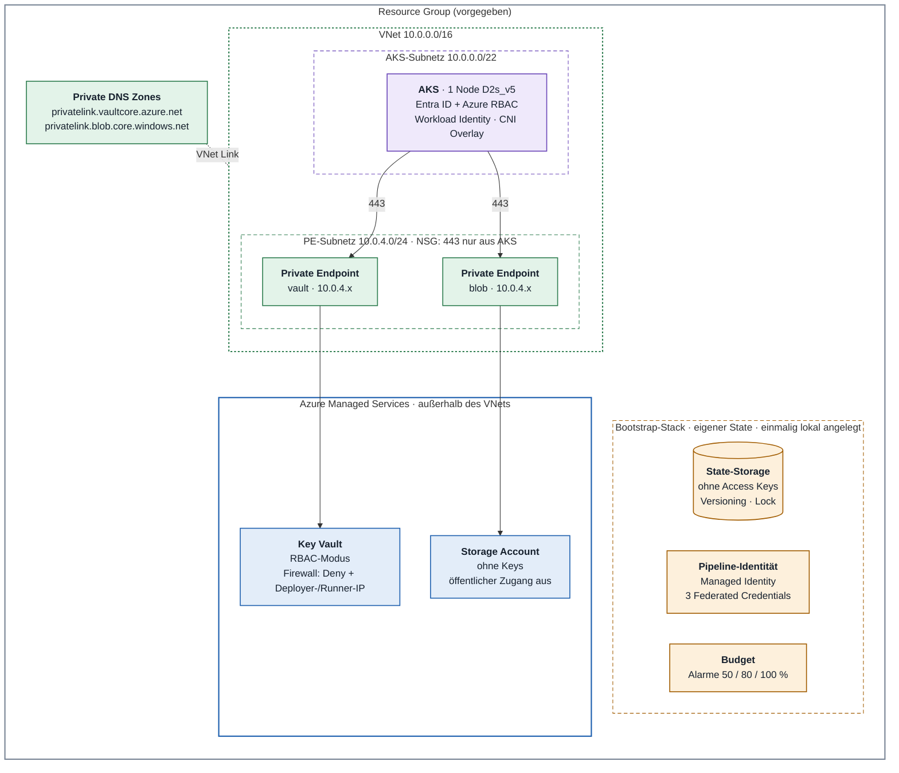
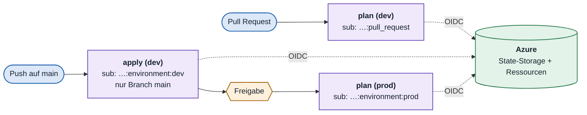

# Azure Private AKS Platform

Eine kleine Azure-Umgebung, vollständig mit **OpenTofu** bereitgestellt: AKS, Key Vault und Storage Account, die **ausschließlich über private IPs** miteinander sprechen, mit Remote State ohne Access Keys und einer Pipeline (GitHub Actions) ohne gespeicherte Secrets.

Lösung der PRODYNA-Praxisaufgabe, **Variante A (DevOps Engineer)** – das Konzept dazu steht in [Abschnitt 10](#10-variante-a--konzept-workload-deployment-und-secret-synchronisation).

|            |                                                                                    |
| ---------- | ---------------------------------------------------------------------------------- |
| IaC        | OpenTofu ≥ 1.10 (getestet mit 1.13.1), Provider `azurerm` 4.x (getestet mit 4.81)  |
| Umgebungen | `dev` (deployed), `prod` (gleicher Code, eigene Werte; in der Pipeline nur `plan`) |
| Pipeline   | GitHub Actions, Anmeldung per OIDC (Workload Identity Federation)                  |
| Region     | Variable `location`, Standard `westeurope`                                         |

---

## Inhalt

1. [Architektur](#1-architektur)
2. [Projektstruktur](#2-projektstruktur)
3. [Begründung der Modul-Aufteilung](#3-begründung-der-modul-aufteilung)
4. [Ausführung](#4-ausführung)
5. [Pipeline](#5-pipeline)
6. [Private Kommunikation prüfen (Demo)](#6-private-kommunikation-prüfen-demo)
7. [Sicherheit und Best Practices](#7-sicherheit-und-best-practices)
8. [Private Networking und delegierte Subnetze](#8-private-networking-und-delegierte-subnetze)
9. [Umgebungen, Kosten, Abbau](#9-umgebungen-kosten-abbau)
10. [Variante A – Konzept](#10-variante-a--konzept-workload-deployment-und-secret-synchronisation)
11. [Entscheidungen im Überblick](#11-entscheidungen-im-überblick)
12. [Grenzen und „mit mehr Zeit“](#12-grenzen-und-mit-mehr-zeit)

---

## 1. Architektur



Die Pfeile zeigen den Datenweg zur Laufzeit; wie Bootstrap und Pipeline die Umgebung anlegen, zeigt [Abschnitt 5](#5-pipeline).

**Kurz:** Pods im AKS lösen den Namen des Key Vaults bzw. Storage Accounts über die verlinkten Private DNS Zones auf eine IP im PE-Subnetz auf (`10.0.4.x`) und erreichen die Dienste über Private Endpoints. Das NSG am PE-Subnetz lässt nur 443 aus dem AKS-Subnetz zu.

---

## 2. Projektstruktur

```text
.
├── bootstrap/                    # einmalig, lokal, mit Owner-Rechten; eigener (lokaler) State
│   ├── state.tf                  #   Storage Account für den Remote State (+ Container, Lock)
│   ├── pipeline-identity.tf      #   Managed Identity der Pipeline, Federated Credentials, Rollen
│   ├── deployer.tf               #   Rollen für die Person, die deployt (Key Vault, AKS, State)
│   ├── budget.tf                 #   Budget mit Alarmen auf der Resource Group
│   ├── main.tf · variables.tf · outputs.tf · versions.tf
│   └── bootstrap.tfvars.example  #   Vorlage für <ziel>.local.tfvars (nicht versioniert)
├── modules/
│   ├── network/                  # VNet, Subnetze, NSG, Private DNS Zones + VNet Links
│   ├── key-vault/                # Key Vault (RBAC), Firewall, Private Endpoint, Demo-Secret
│   ├── storage/                  # Storage Account ohne Keys, Container, Private Endpoint
│   ├── aks/                      # Control-Plane-Identität, AKS-Cluster
│   └── workload-identity/        # Managed Identity + Federated Credential + Rollen pro Anwendung
├── infra/                        # Root-Modul: verdrahtet die Module für eine Umgebung
│   ├── main.tf · variables.tf · outputs.tf · versions.tf · backend.tf
│   ├── local.tfvars.example      #   Vorlage für zielspezifische Werte (nicht versioniert)
│   └── environments/
│       ├── dev.tfvars   · dev.backend.hcl
│       └── prod.tfvars  · prod.backend.hcl
├── k8s/demo/demo.yaml            # Namespace, annotierter ServiceAccount, Test-Pod
└── .github/
    ├── actions/tofu-init/        # gemeinsame Schritte: OpenTofu, OIDC-Login, init, Key-Vault-Firewall
    └── workflows/
        ├── infra-plan.yml        # Pull Request → plan (dev)
        └── infra-deploy.yml      # main → apply (dev) → plan (prod, mit Freigabe)
```

**Wo welche Werte liegen**

| Datei                                  | Inhalt                                                                                  | Versioniert |
| -------------------------------------- | --------------------------------------------------------------------------------------- | ----------- |
| `infra/variables.tf`                   | alle einstellbaren Werte mit Typ, Beschreibung, Validierung                             | ja          |
| `infra/environments/<env>.tfvars`      | was sich **pro Umgebung** unterscheidet (Netzbereiche, Node-Anzahl, Purge Protection …) | ja          |
| `infra/environments/<env>.backend.hcl` | nur der State-Key (`dev.tfstate` / `prod.tfstate`)                                      | ja          |
| `infra/<ziel>.local.tfvars`            | was sich **pro Ziel** unterscheidet: Subscription, Resource Group, Region, eigene IP    | **nein**    |
| `infra/backend.local.hcl`              | wo der State-Storage dieses Ziels liegt (vom Bootstrap erzeugt)                         | **nein**    |

So steht keine Subscription-ID, keine Tenant-ID und keine IP im Repository.

---

## 3. Begründung der Modul-Aufteilung

Ich schneide Module nach **Verantwortung** (wem würde der Teil in einem Unternehmen gehören, welche Frage beantwortet er) und nach **Lebenszyklus** (wann ändert er sich, womit entsteht und verschwindet er) – nicht ein Modul pro Ressource.

| Teil                                        | Verantwortung                                                      | Ändert sich …               | Konsequenz                                                                                                                                                           |
| ------------------------------------------- | ------------------------------------------------------------------ | --------------------------- | -------------------------------------------------------------------------------------------------------------------------------------------------------------------- |
| `bootstrap/`                                | Plattform / Sicherheit: State-Speicher, Pipeline-Identität, Budget | fast nie                    | **eigener State**, einmalig lokal ausgeführt; der State-Speicher kann nicht in sich selbst liegen                                                                    |
| `modules/network`                           | Netzwerk                                                           | selten                      | eigenes Modul. Die **Private DNS Zones gehören hierher**, weil alle Private Endpoints sie teilen – in einer Landing Zone lägen sie im Hub                            |
| `modules/key-vault`, `modules/storage`      | je ein Dienst                                                      | gelegentlich                | **der Private Endpoint gehört zum Dienst**: „ein privat erreichbarer Key Vault“ ist eine Einheit. Ein generisches Private-Endpoint-Modul wäre nur ein dünner Wrapper |
| `modules/aks`                               | Plattform                                                          | alle paar Monate (Upgrades) | eigenes Modul inkl. Control-Plane-Identität                                                                                                                          |
| `modules/workload-identity`                 | Anwendung                                                          | mit jeder neuen Anwendung   | klein und wiederverwendbar: eine Identität pro Anwendung, nur mit ihren Rollen                                                                                       |
| Workloads (Demo-Pod, später nginx/Operator) | Anwendungsteams                                                    | täglich                     | **nicht im Infrastruktur-State** (`k8s/`, später GitOps)                                                                                                             |

Die Module haben kleine Schnittstellen (`variables.tf` = Eingaben, `outputs.tf` = Ergebnisse). `infra/main.tf` enthält keine Logik, nur die Verdrahtung: Ausgaben eines Moduls sind Eingaben eines anderen (z. B. `module.aks.oidc_issuer_url` → `module.demo_identity`), wodurch OpenTofu auch die Reihenfolge ableitet. Module konfigurieren keinen Provider – das macht nur das Root-Modul.

---

## 4. Ausführung

### Voraussetzungen

- OpenTofu ≥ 1.10, Azure CLI, `kubectl` und `kubelogin`
- Eine bestehende Resource Group, auf der man **Owner** ist (oder Contributor + Role Based Access Control Administrator)
- Registrierte Resource Provider: `Microsoft.ContainerService`, `Microsoft.KeyVault`, `Microsoft.Network`, `Microsoft.Storage`, `Microsoft.ManagedIdentity`. Der Provider registriert sie bewusst **nicht** selbst (`resource_provider_registrations = "none"`), weil dafür Rechte auf Subscription-Ebene nötig wären.

```bash
az login
az account set --subscription <subscription-id>
```

### Schritt 1 – Bootstrap (einmalig)

Legt den State-Speicher, die Pipeline-Identität, die Rollen und das Budget an. Pro Ziel (eigene Test-Subscription, PRODYNA-Subscription) gibt es einen **lokalen Workspace**, damit sich die States nicht vermischen.

```bash
cd bootstrap
cp bootstrap.tfvars.example own.local.tfvars     # Werte eintragen
tofu init
tofu workspace new own
tofu apply -var-file=own.local.tfvars -parallelism=1
```

`-parallelism=1`: Azure erlaubt keine parallelen Schreibvorgänge mehrerer Federated Credentials auf derselben Managed Identity.

### Schritt 2 – Infrastruktur (lokal)

```bash
cd ..
tofu -chdir=bootstrap output -raw backend_config > infra/backend.local.hcl
cd infra
cp local.tfvars.example own.local.tfvars         # Werte eintragen (eigene IP: curl -4 -s https://ifconfig.me)
tofu init -backend-config=backend.local.hcl -backend-config=environments/dev.backend.hcl
tofu plan  -var-file=environments/dev.tfvars -var-file=own.local.tfvars
tofu apply -var-file=environments/dev.tfvars -var-file=own.local.tfvars
```

Die beiden `-backend-config` werden zusammengeführt: das erste sagt, **wo** der State-Speicher liegt, das zweite, **welche Datei** (`dev.tfstate`). Bei den `-var-file` gewinnt die letzte Datei.

Dauer: ca. 10–15 Minuten (AKS ist der langsamste Teil).

---

## 5. Pipeline



Jeder Job meldet sich per OIDC an: Das Token von GitHub enthält das Subject (`sub`) des Jobs, Entra ID tauscht es gegen ein Token der Pipeline-Identität. Den Bootstrap-Stack (State-Speicher, Pipeline-Identität, Budget) legt vorher einmalig eine Person mit Owner-Rechten lokal an.

- **Anmeldung ohne Secrets:** GitHub stellt pro Job ein OIDC-Token aus; Entra ID tauscht es gegen ein Azure-Token, wenn eine Federated Credential der Pipeline-Identität passt (Issuer `https://token.actions.githubusercontent.com`, Subject, Audience `api://AzureADTokenExchange`). Provider und Backend nutzen dafür `ARM_USE_OIDC=true`.
- **Subject-Format:** GitHub sendet die unveränderlichen IDs von Besitzer und Repository (`repo:<owner>@<owner_id>/<repo>@<repo_id>:…`). Ein später mit gleichem Namen neu angelegtes Repository kann die Identität dadurch nicht übernehmen. Der Wert steht in `github_oidc_subject_repo` (Bootstrap).
- **Rechte der Pipeline (Least Privilege):** Contributor auf der Resource Group; **Role Based Access Control Administrator mit Condition** – sie darf nur drei Rollen vergeben (Key Vault Secrets User, Network Contributor, Storage Blob Data Contributor), sich also z. B. nicht selbst zum Owner machen; Key Vault Secrets Officer; Storage Blob Data Contributor nur auf dem State-Speicher.
- **Key-Vault-Firewall:** Der Runner hat bei jedem Lauf eine andere öffentliche IP. Die Action `tofu-init` trägt diese IP vor dem Plan in die Firewall ein (auch als `TF_VAR_runner_ip_cidrs`, damit kein Drift entsteht) und entfernt sie am Ende des Jobs wieder (`if: always()`).
- **Gesperrter State, keine Parallelläufe:** `concurrency` pro Umgebung plus `-lock-timeout=5m`.
- `apply` wendet genau den im selben Job erzeugten Plan an (`plan -out` → `apply dev.tfplan`).

**Einrichtung (einmalig)**

1. _Settings → Environments_: `dev` (Deployment-Branch: `main`), `prod` (Required reviewers + Deployment-Branch `main`).
2. Secrets und Variablen (Werte aus `tofu -chdir=bootstrap output`):

| Name                       | Typ      | Inhalt                                   |
| -------------------------- | -------- | ---------------------------------------- |
| `ARM_CLIENT_ID`            | Secret   | `pipeline_client_id`                     |
| `ARM_TENANT_ID`            | Secret   | `tenant_id`                              |
| `ARM_SUBSCRIPTION_ID`      | Secret   | Ziel-Subscription                        |
| `TF_STATE_RESOURCE_GROUP`  | Secret   | Resource Group (State und Infrastruktur) |
| `ADMIN_IP_CIDRS`           | Secret   | z. B. `["203.0.113.10/32"]`              |
| `TF_STATE_STORAGE_ACCOUNT` | Variable | `state_storage_account_name`             |
| `LOCATION`                 | Variable | Region                                   |

IDs sind keine Geheimnisse, liegen aber als **Secrets** vor: In einem öffentlichen Repository sind die Actions-Logs öffentlich, und GitHub maskiert nur Secrets – so erscheinen z. B. Subscription-IDs in Ressourcen-IDs als `***`.

---

## 6. Private Kommunikation prüfen (Demo)

```bash
az aks get-credentials -g <resource-group> -n "$(tofu -chdir=infra output -raw aks_name)" --overwrite-existing
kubelogin convert-kubeconfig -l azurecli
kubectl get nodes

# Test-Pod mit Workload Identity (die Client-ID wird erst hier eingesetzt, sie steht nicht im Repo)
sed "s/__CLIENT_ID__/$(tofu -chdir=infra output -raw demo_client_id)/" k8s/demo/demo.yaml | kubectl apply -f -
kubectl -n demo wait --for=condition=Ready pod/kv-probe --timeout=120s

KV=$(tofu -chdir=infra output -raw key_vault_name)
ST=$(tofu -chdir=infra output -raw storage_account_name)
kubectl -n demo exec kv-probe -- sh -c "
  az login --service-principal -u \$AZURE_CLIENT_ID -t \$AZURE_TENANT_ID \
    --federated-token \"\$(cat \$AZURE_FEDERATED_TOKEN_FILE)\" --allow-no-subscriptions -o none &&
  python3 -c \"import socket; print('KV ->', socket.gethostbyname('$KV.vault.azure.net')); print('ST ->', socket.gethostbyname('$ST.blob.core.windows.net'))\" &&
  az keyvault secret show --vault-name $KV --name mysql-connection-string --query value -o tsv | cut -c1-40 &&
  az storage container list --auth-mode login --account-name $ST --query '[].name' -o tsv"
```

Ergebnis im Vergleich (Split-Horizon-DNS):

| Von                   | Key Vault      | Storage        | Secret lesen                                | Container auflisten           |
| --------------------- | -------------- | -------------- | ------------------------------------------- | ----------------------------- |
| **Pod im AKS**        | `10.0.4.x`     | `10.0.4.x`     | ✓ (Workload Identity, Private Endpoint)     | ✓                             |
| **Laptop (Internet)** | öffentliche IP | öffentliche IP | ✓ nur dank Firewall-Regel für die eigene IP | ✗ öffentlicher Zugang ist aus |

Der Pod meldet sich ohne Passwort an: Der Webhook von Workload Identity legt ein Token des ServiceAccounts in den Pod; Entra ID tauscht es gegen ein Token der Managed Identity, weil deren Federated Credential genau diesen ServiceAccount (`system:serviceaccount:demo:kv-reader`) des Clusters zulässt. Die Berechtigung kommt aus der Rolle _Key Vault Secrets User_ auf dem Key Vault.

---

## 7. Sicherheit und Best Practices

**Remote State**

- Eigener Storage Account (vom Bootstrap), **ohne Access Keys** (`shared_access_key_enabled = false`): Zugriff nur mit Entra-ID-Token und Rolle _Storage Blob Data Contributor_.
- Blob Versioning und 7 Tage Soft Delete: jede Schreiboperation ist wiederherstellbar.
- Locking nativ über den Blob Lease; ein **Management Lock** (`CanNotDelete`) schützt den Account.
- Getrennte States: Bootstrap (lokal), `dev.tfstate`, `prod.tfstate`.

**Secrets**

- Kein Secret im Code oder in versionierten Dateien.
- Das Demo-Secret (MySQL-Connection-String) wird mit `ephemeral "random_password"` erzeugt und über das **Write-only-Attribut** `value_wo` in den Key Vault geschrieben – es landet **weder im Plan noch im State**. Rotation: `secret_version` erhöhen.
- Die Pipeline nutzt OIDC statt Client Secret; Workloads nutzen Workload Identity statt Secrets im Cluster.

**Zugriffsrechte (RBAC)**

- Key Vault im **RBAC-Modus** (keine Access Policies); Datenrollen getrennt von Verwaltungsrollen.
- AKS mit **Entra ID und Azure RBAC**, lokale Accounts deaktiviert (kein statisches Admin-Kubeconfig).
- Control-Plane-Identität von AKS: eigene Managed Identity mit _Network Contributor_ **nur auf dem AKS-Subnetz**, vor dem Cluster angelegt.
- Rollen für Menschen vergibt der Bootstrap (ausgeführt von einer Person mit Owner), Rollen für Identitäten, die in `infra/` entstehen, vergibt die Pipeline – deshalb braucht sie nur drei delegierbare Rollen.

**Code**

- Alle Werte über `variables.tf`, mit Typen, Beschreibungen und Validierungen (z. B. Namenslängen, CIDR-Format, `dev`/`prod`).
- Provider-Versionen gepinnt, `.terraform.lock.hcl` versioniert; in `infra/` mit Hashes für `linux_amd64` (Runner) und `darwin_arm64`.
- `tofu fmt -check` und `tofu validate` in der Pipeline.

---

## 8. Private Networking und delegierte Subnetze

| Baustein          | Umsetzung                                                                                                              | Warum                                                                                                                              |
| ----------------- | ---------------------------------------------------------------------------------------------------------------------- | ---------------------------------------------------------------------------------------------------------------------------------- |
| Private Endpoints | Key Vault (`vault`) und Storage (`blob`) im PE-Subnetz `10.0.4.0/24`                                                   | Dienste bekommen eine IP im eigenen VNet; kein Verkehr über das Internet, Schutz gegen Datenabfluss (anders als Service Endpoints) |
| Private DNS Zones | `privatelink.vaultcore.azure.net`, `privatelink.blob.core.windows.net`, mit dem VNet verlinkt                          | ohne verlinkte Zone löst der Name weiter öffentlich auf – der Private Endpoint würde still umgangen                                |
| A-Records         | `private_dns_zone_group` am Private Endpoint                                                                           | Azure legt die Records an und entfernt sie wieder; keine doppelt gepflegten IPs                                                    |
| NSG am PE-Subnetz | erlaubt 443 aus `10.0.0.0/22`, verweigert den Rest des VNets (Priorität 4000 vor der Standardregel `AllowVnetInBound`) | **`private_endpoint_network_policies = "Enabled"`** ist nötig, sonst wirkt das NSG auf Private Endpoints nicht                     |
| Storage           | `public_network_access_enabled = false`                                                                                | Container werden über die ARM-API angelegt (Steuerungsebene), der öffentliche Datenzugang kann komplett zu bleiben                 |
| Key Vault         | öffentlicher Zugang an, aber Firewall `Deny` + nur Deployer- und Runner-IP                                             | Deployer und GitHub-Runner schreiben das Secret über die Datenebene; der private Weg läuft nicht über diese Firewall               |
| AKS API Server    | öffentlich, nur für autorisierte IP-Bereiche                                                                           | Verwaltung von außen ohne Bastion oder VPN                                                                                         |
| AKS-Netzwerk      | Azure CNI Overlay + Cilium; Pods `192.168.0.0/16`, Services `172.16.0.0/16`, DNS `172.16.0.10`                         | Pods verbrauchen keine VNet-IPs; der Standard-Service-Bereich `10.0.0.0/16` würde mit dem VNet kollidieren                         |

**Delegierte Subnetze:** Eine Delegation reserviert ein Subnetz für einen PaaS-Dienst, der eigene Ressourcen in das VNet injiziert (z. B. Azure Container Instances, App Service VNet Integration, PostgreSQL Flexible Server, Private DNS Resolver, AKS mit API Server VNet Integration). In dieser Lösung braucht **kein** Subnetz eine Delegation: Die AKS-Nodes sind normale VMs (VM Scale Set) mit Netzwerkkarten im Subnetz, Private Endpoints sind Netzwerkkarten, und Pod-IPs kommen bei CNI Overlay nicht aus dem Subnetz. Eine unnötige Delegation würde das Subnetz für andere Ressourcen sperren. Würde man den API Server per VNet Integration privat machen, käme ein eigenes, an `Microsoft.ContainerService/managedClusters` delegiertes Subnetz hinzu.

---

## 9. Umgebungen, Kosten, Abbau

**Umgebungen:** ein Root-Modul, Werte pro Umgebung in `environments/<env>.tfvars`, eigener State pro Umgebung. `prod.tfvars` zeigt die Unterschiede (2 Nodes, eigener Adressbereich `10.1.0.0/16`, 90 Tage Soft Delete, Purge Protection). Vorgesehen ist eine Subscription pro Umgebung; da hier eine Subscription zur Verfügung steht, wird `prod` nur geplant.

**Kosten (Richtwerte, Azure Retail Prices, West Europe)**

| Posten                                            | ca.                                  |
| ------------------------------------------------- | ------------------------------------ |
| AKS-Node `Standard_D2s_v5`                        | 0,10 €/h                             |
| OS-Disk 64 GB (P6)                                | 10 €/Monat                           |
| Standard Load Balancer + öffentliche IP (Ausgang) | 0,03 €/h                             |
| 2 Private Endpoints                               | 0,018 €/h + Datenvolumen             |
| 2 Private DNS Zones                               | 0,90 €/Monat                         |
| Key Vault, Storage                                | nach Nutzung, praktisch Cent-Beträge |
| **Gesamt dev**                                    | **≈ 0,15 €/h, ≈ 3,60 €/Tag**         |

AKS läuft im Free Tier (kein SLA). Das Budget im Bootstrap alarmiert bei 50 %, 80 % und prognostizierten 100 % – es stoppt aber nichts. Deshalb: Tags auf allen Ressourcen und Abbau nach jedem Test.

**Abbau**

```bash
cd infra
tofu destroy -var-file=environments/dev.tfvars -var-file=own.local.tfvars
cd ../bootstrap
tofu destroy -var-file=own.local.tfvars -parallelism=1   # entfernt zuerst den Management Lock
```

Der Key Vault bleibt nach dem Löschen 7 Tage im Soft Delete und wird bewusst nicht gepurgt (`purge_soft_delete_on_destroy = false`): Purgen erfordert Rechte auf Subscription-Ebene. Namenskonflikte entstehen nicht, weil jeder Key Vault ein zufälliges Suffix hat.

---

## 10. Variante A – Konzept: Workload Deployment und Secret-Synchronisation

### 10.1 Grundsatz: Infrastruktur und Workloads getrennt

Cluster und Workloads haben **verschiedene Lebenszyklen** (Monate vs. Tage) und verschiedene Verantwortliche. Deshalb gehören Deployments **nicht** in denselben OpenTofu-State wie der Cluster: Ein Fehler in einem nginx-Manifest darf kein `apply` der Infrastruktur blockieren, und ein Cluster-Neuaufbau soll die Workloads einfach wieder ausrollen. Bereits umgesetzt ist die Grundlage dafür – Cluster mit Workload Identity und das wiederverwendbare Modul `workload-identity`.

### 10.2 Webserver (nginx) als Deployment + Service, staging- und production-tauglich

**Paketierung: Kustomize** (Base + Overlays je Umgebung), alternativ ein Helm-Chart mit `values-staging.yaml` / `values-production.yaml`. Kustomize genügt für eigene Manifeste ohne Templating; Helm wäre die Wahl für ein verteiltes, parametrisiertes Paket.

```text
k8s/apps/nginx/
├── base/                      # Deployment, Service, ConfigMap, NetworkPolicy, PodDisruptionBudget
└── overlays/
    ├── staging/               # 1 Replica, kleine Requests, Namespace staging
    └── production/            # 3 Replicas, HPA, größere Requests, Namespace production
```

**Auslieferung: GitOps (Argo CD oder Flux)** statt `helm_release` aus OpenTofu.

|              | GitOps (Pull)                                              | `helm_release` / `kubernetes` Provider (Push)                                      |
| ------------ | ---------------------------------------------------------- | ---------------------------------------------------------------------------------- |
| Wer deployt  | Controller im Cluster gleicht laufend mit Git ab           | OpenTofu bei jedem `apply`                                                         |
| Drift        | wird automatisch korrigiert                                | wird erst beim nächsten Plan sichtbar                                              |
| Zugangsdaten | die Pipeline braucht keinen Zugriff auf die Kubernetes-API | die Pipeline braucht Cluster-Credentials (API Server müsste für Runner offen sein) |
| Kopplung     | Workloads unabhängig vom Infrastruktur-State               | Cluster und Workloads im selben Lebenszyklus                                       |

Eine Argo-CD-`Application` pro Umgebung zeigt auf das jeweilige Overlay. **Promotion:** Ein neuer Image-Tag wird per Pull Request zuerst im Staging-Overlay gesetzt und nach erfolgreichem Test per Pull Request ins Production-Overlay übernommen – Git ist die Historie aller Deployments.

**Was „production-tauglich“ konkret heißt**

- Image mit festem Tag oder Digest (kein `latest`), z. B. `nginxinc/nginx-unprivileged`
- `securityContext`: `runAsNonRoot`, `readOnlyRootFilesystem`, keine Privilegien, Capabilities entfernt
- Requests/Limits, `readinessProbe` und `livenessProbe`
- Production: mehrere Replicas, `PodDisruptionBudget`, `HorizontalPodAutoscaler`, Verteilung über Nodes/Zonen (`topologySpreadConstraints`)
- `NetworkPolicy` (Cilium ist aktiv): nur Ingress vom Ingress-Controller, Egress nur zu den benötigten Zielen
- Service vom Typ `ClusterIP`, Freigabe über einen Ingress-Controller (z. B. AKS Application Routing) mit TLS (cert-manager oder Zertifikat aus dem Key Vault)
- Getrennte Namespaces mit `ResourceQuota`; in einem echten Setup getrennte Cluster/Subscriptions je Umgebung

### 10.3 Operator: Secret aus dem Key Vault in den Cluster synchronisieren

**Optionen**

|                | External Secrets Operator (ESO)                                    | Secrets Store CSI Driver (AKS-Add-on)               |
| -------------- | ------------------------------------------------------------------ | --------------------------------------------------- |
| Art            | echter Operator mit CRDs (`SecretStore`, `ExternalSecret`)         | CSI-Treiber: mountet Secrets als Dateien in den Pod |
| Ergebnis       | normales Kubernetes-`Secret` (Umgebungsvariable oder Volume)       | Datei im Pod; `Secret` nur optional per Sync        |
| Aktualisierung | periodisch (`refreshInterval`)                                     | beim Pod-Start bzw. per Rotation-Polling            |
| Backends       | viele (Key Vault, AWS, Vault, …)                                   | providerabhängig                                    |
| GitOps         | sehr gut: `ExternalSecret` beschreibt, _welches_ Secret, ohne Wert | gut (`SecretProviderClass`)                         |

**Wahl: External Secrets Operator.** Er erzeugt native Kubernetes-Secrets, die Anwendungen ohne Anpassung als Umgebungsvariable nutzen können, und die Konfiguration passt in GitOps: Im Repository steht nur die Referenz, nie der Wert. Der CSI-Treiber wäre die Wahl, wenn Secrets ausdrücklich nicht in etcd liegen sollen.

**Authentifizierung: Workload Identity** – genau der in dieser Lösung umgesetzte und demonstrierte Mechanismus. Für ESO wird das Modul `workload-identity` ein zweites Mal aufgerufen:

```hcl
module "eso_identity" {
  source               = "../modules/workload-identity"
  name                 = "${local.name_prefix}-eso"
  resource_group_name  = data.azurerm_resource_group.this.name
  location             = var.location
  oidc_issuer_url      = module.aks.oidc_issuer_url
  namespace            = "external-secrets"
  service_account_name = "external-secrets"
  role_assignments = {
    kv_secrets = { scope = module.key_vault.id, role = "Key Vault Secrets User" }
  }
}
```

ESO selbst wird per Helm (über GitOps) in den Namespace `external-secrets` installiert; dessen ServiceAccount erhält die Annotationen `azure.workload.identity/client-id` (Wert: `module.eso_identity.client_id`) und `azure.workload.identity/tenant-id`. Danach:

```yaml
apiVersion: external-secrets.io/v1
kind: ClusterSecretStore
metadata:
  name: azure-key-vault
spec:
  provider:
    azurekv:
      authType: WorkloadIdentity
      vaultUrl: https://<key-vault-name>.vault.azure.net
      serviceAccountRef:
        name: external-secrets
        namespace: external-secrets
---
apiVersion: external-secrets.io/v1
kind: ExternalSecret
metadata:
  name: mysql-connection
  namespace: production
spec:
  refreshInterval: 1h
  secretStoreRef:
    kind: ClusterSecretStore
    name: azure-key-vault
  target:
    name: mysql-connection # Kubernetes-Secret, das ESO anlegt und aktuell hält
  data:
    - secretKey: connectionString
      remoteRef:
        key: mysql-connection-string
```

Der Weg zum Key Vault ist derselbe wie in der Demo: DNS über die private Zone → `10.0.4.x` → NSG → Private Endpoint; Berechtigung über _Key Vault Secrets User_.

**Rotation:** `secret_version` im Key-Vault-Modul erhöhen → neues Passwort, neue Version im Key Vault → ESO aktualisiert das Kubernetes-Secret beim nächsten `refreshInterval` → Pods übernehmen es per Neustart (z. B. mit Stakater Reloader) oder lesen es als Volume neu ein.

**Absicherung im Cluster:** Kubernetes-Secrets liegen in etcd – bei AKS verschlüsselt im Ruhezustand, optional zusätzlich mit KMS (eigener Key im Key Vault). Leserechte auf Secrets nur pro Namespace über Azure RBAC; für Staging und Production getrennte Key Vaults bzw. Identitäten.

---

## 11. Entscheidungen im Überblick

| Thema                       | Entscheidung                                           | Verworfen, weil …                                                                                                                |
| --------------------------- | ------------------------------------------------------ | -------------------------------------------------------------------------------------------------------------------------------- |
| IaC-Werkzeug                | OpenTofu                                               | Terraform gleichwertig, aber BSL-Lizenz; Bicep nur für Azure                                                                     |
| State                       | eigener Storage Account ohne Keys, im Bootstrap        | im Storage der Anwendung: beim Schließen des Netzes oder `destroy` wäre der State weg                                            |
| Umgebungen                  | ein Root-Modul + `<env>.tfvars` + eigener State        | Ordner pro Umgebung: doppelte `variables.tf`; Workspaces: gleiches Backend und gleiche Credentials für alle Umgebungen           |
| Zugang zu Key Vault/Storage | Private Endpoints                                      | Service Endpoints: Ziel bleibt öffentlich, kein Schutz gegen Datenabfluss, nicht aus gepeerten Netzen erreichbar                 |
| A-Records                   | `private_dns_zone_group`                               | manuell: doppelte Pflege; per Azure Policy: richtig bei zentralen Zonen in einer Landing Zone                                    |
| Key Vault                   | RBAC-Modus, Firewall mit Deployer-/Runner-IP           | Access Policies: Altmodell; komplett geschlossen: Runner im Internet könnte nicht schreiben (Lösung: Self-hosted Runner im VNet) |
| AKS                         | Free Tier, 1 × `D2s_v5`, keine Zonen, Overlay + Cilium | Zonen: `D2s_v5` ist in der Ziel-Subscription in Zone 1 und 3 nicht verfügbar; Ausweichgröße `D2as_v5` geprüft                    |
| Pipeline-Rechte             | Contributor + RBAC Administrator mit Condition         | Owner: könnte sich beliebige Rechte geben                                                                                        |
| Pod-Identität               | Workload Identity                                      | Kubelet-Identität: teilen sich alle Pods eines Nodes; Secret eines Service Principals im Cluster: „Secret Zero“-Problem          |
| Repository                  | öffentlich, ohne IDs und IPs                           | privat mit Einladungen: mehr Aufwand für Reviewer                                                                                |

---

## 12. Grenzen und „mit mehr Zeit“

- **Zwei Pipeline-Identitäten:** eine nur lesende für Pull Requests (Reader + State-Lock) und eine schreibende für die Environments. Heute nutzen alle Jobs dieselbe Identität; ein Pull Request könnte den Workflow ändern und mit Schreibrechten laufen.
- **Self-hosted Runner im VNet:** dann kann die öffentliche Seite des Key Vaults (und des State-Speichers) komplett geschlossen werden; zusammen mit einem **privaten AKS-Cluster** gäbe es keine öffentlichen Endpunkte mehr.
- **Plan-Artefakt:** den im Pull Request geprüften Plan speichern und nach der Freigabe genau diesen anwenden.
- **Beobachtbarkeit:** Log Analytics mit Diagnoseeinstellungen des Key Vaults (`AuditEvent`: wer hat welches Secret gelesen), Container Insights, Managed Prometheus und Grafana, Alerts.
- **Production-Härtung:** AKS Standard Tier (SLA), mehrere Nodes über Zonen, gepinnte Kubernetes-Version, ZRS/GRS für Storage, Purge Protection.
- **Qualität und Kosten in der Pipeline:** `tflint`, `checkov`, Infracost-Kommentar im Pull Request, geplanter `plan` zur Drift-Erkennung.
- **Variante A umsetzen:** ESO und nginx per Argo CD wie in Abschnitt 10 beschrieben.
- **Lebenszyklus-Regel** für alte State-Versionen im Blob Storage.
